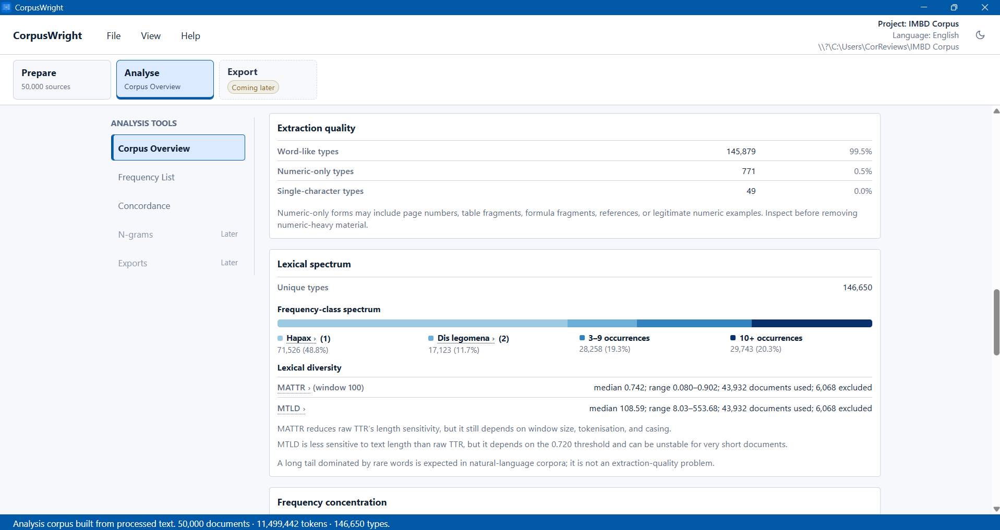

# CorpusWright

[](<https://github.com/jhlopesalves/CorpusWright/actions/workflows/ci.yml>)
[](https://github.com/jhlopesalves/CorpusWright/releases/latest)
[](<https://jhlopesalves.github.io/CorpusWright/>)
[](LICENSE)

A local-first desktop workbench for corpus linguistics: clean messy text,
count what matters, and read the evidence — with every step visible and
reproducible.



Corpus work usually starts with a tedious problem: the text files are messy.
PDFs arrive with running headers, page numbers, and OCR slip-ups baked into
the extracted text; DOCX files smuggle in footnotes and comments you never
asked for. CorpusWright is my attempt to make that stage less miserable -
load the documents, see exactly what was extracted, apply cleaning rules you
can save and re-run, then analyse the result without leaving the app.
Everything runs on your machine; nothing is uploaded anywhere.

## For researchers

**Download the latest experimental alpha:** [CorpusWright releases](https://github.com/jhlopesalves/CorpusWright/releases/latest)

Experimental alpha; Windows installers may trigger the usual unsigned-app warnings.

- **[Quick start](<https://jhlopesalves.github.io/CorpusWright/quick-start.html>)** —
  from installer to first cleaned corpus.
- **[Concepts](<https://jhlopesalves.github.io/CorpusWright/learn.html>)** —
  what the numbers mean and why the defaults are what they are.
- **[How to cite](<https://jhlopesalves.github.io/CorpusWright/citation.html>)** —
  or use GitHub's "Cite this repository" widget, backed by [`CITATION.cff`](CITATION.cff).

**Current `CITATION.cff`:**
```yaml
cff-version: 1.2.0
message: "If you use CorpusWright in your research or teaching, please cite it as below."
title: CorpusWright
abstract: >-
  A desktop corpus-linguistics workbench with a Rust core for cleaning,
  inspecting, and analysing research corpora with statistical and
  methodological rigour. Local-first, auditable, and analysis-aware.
type: software
authors:
  - family-names: Lopes
    given-names: Jhonatan Henrique
    orcid: "https://orcid.org/0009-0008-4914-0262"
    email: jhlopesalves@gmail.com
repository-code: "https://github.com/jhlopesalves/CorpusWright"
url: "https://jhlopesalves.github.io/CorpusWright/"
version: 0.1.0-alpha.8
date-released: "2026-06-29"
license: MIT
keywords:
  - corpus linguistics
  - text processing
  - concordance
  - KWIC
  - reproducibility
  - Rust
```

## For developers

A Rust core does the corpus-scale work; Tauri provides the desktop shell;
TypeScript and Vite drive the interface.


```

crates/corpuswright-core/ extraction, cleaning, analysis, search, export

apps/desktop/ Tauri v2 app + TypeScript/Vite frontend

docs/ reference documentation and design notes

examples/ sample corpora and usage material

legacy/pyside/ the original PySide6 prototype, kept for reference

```

Run it in development mode:


```
cd apps/desktop
npm ci
npm run tauri dev
```

Test the core:

```
cargo test -p corpuswright-core
cargo check -p corpuswright-desktop --all-targets
```

Reference documentation lives in [`docs/`](docs/), starting with
[corpus projects](README.md) and
[supported formats](README.md).

## Status

This is alpha, and it behaves like alpha. The preparation pipeline - import,
preview, cleaning, artefact review, export - is in place, and the first
analysis tools (frequency lists, KWIC concordance, collocates) are usable and
under active development. What's planned and what's next live on the
[roadmap](<https://jhlopesalves.github.io/CorpusWright/roadmap.html>).

## License

MIT. Bundled third-party components are listed in
[THIRD_PARTY_NOTICES.md](THIRD_PARTY_NOTICES.md).
