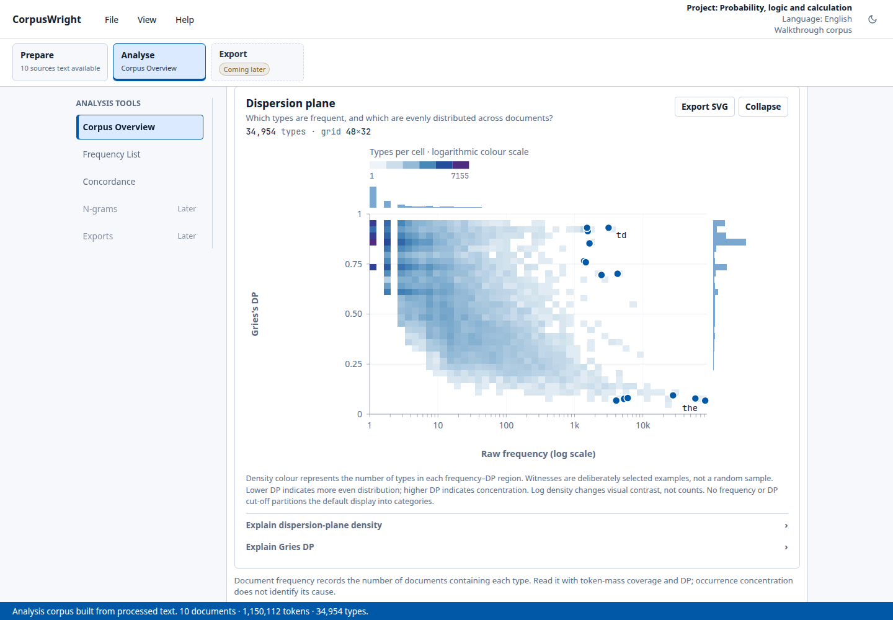
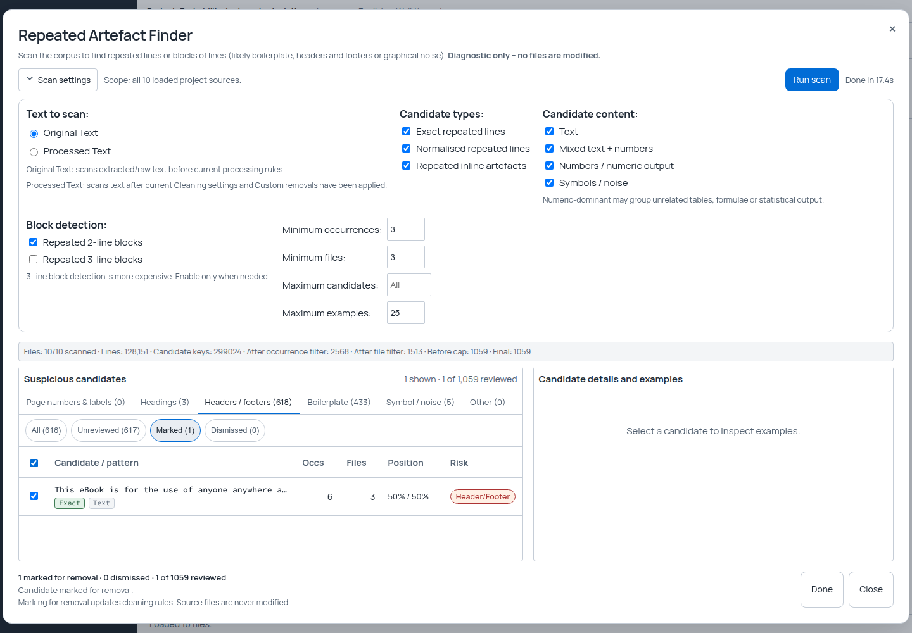
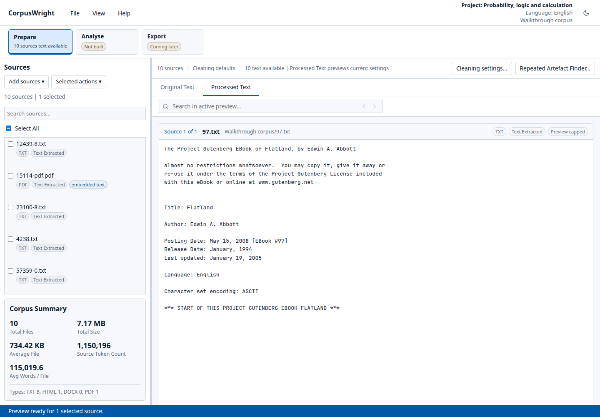
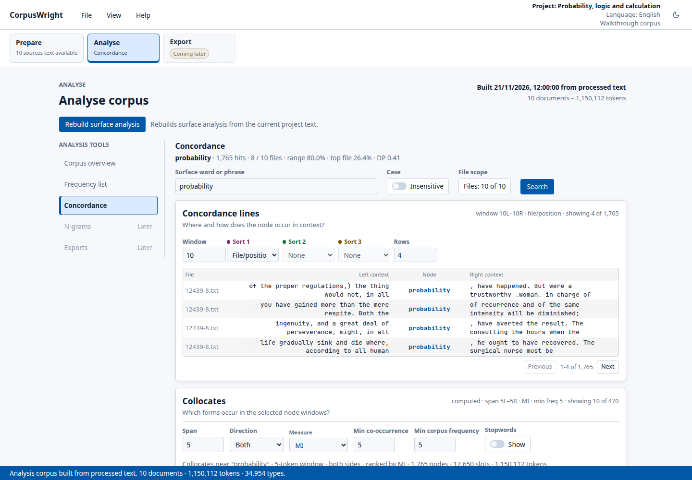

#  CorpusWright

[](https://github.com/jhlopesalves/CorpusWright/actions/workflows/ci.yml)
[](https://github.com/jhlopesalves/CorpusWright/releases/latest)
[](https://jhlopesalves.github.io/CorpusWright/)
[](LICENSE)

**Desktop software for preparing text corpora, describing them statistically and reading the occurrences behind the counts.**

CorpusWright takes PDF, DOCX, HTML and plain-text sources through preparation, description and reading in a single workflow, and keeps every step between the files and the figures open to inspection. Corpus files are processed on your computer.

[Download CorpusWright](https://github.com/jhlopesalves/CorpusWright/releases/latest) ·
[Guide](https://jhlopesalves.github.io/CorpusWright/quick-start.html) ·
[Methods](https://jhlopesalves.github.io/CorpusWright/concepts/overview.html) ·
[Citation](CITATION.cff)

<picture>
  <source media="(prefers-color-scheme: dark)" srcset="docs/assets/walkthrough/05-dispersion-dark.png">
  
</picture>

<sub>The Dispersion plane for ten nineteenth-century works on logic, probability and related subjects, 1,150,112 tokens after cleaning. The <a href="https://jhlopesalves.github.io/CorpusWright/">walkthrough</a> on the website follows this corpus from its files to its figures.</sub>

## From the files to the figures and back

**Prepare.** Import the sources and read what was extracted before anything is counted. PDFs are read from their embedded text by default, and a scanned PDF can be imported with full OCR instead. The Repeated Artefact Finder groups recurring lines and short blocks, such as licence notices and running heads, so that each removal rule is reviewed before it is accepted. The Original Text and Processed Text tabs show what the rules change, and the source files are never modified.

**Analyse.** Build the corpus from the processed text and describe it: frequency with range and Gries's DP, the Dispersion plane, lexical diversity, concentration and vocabulary growth. Lemma and part-of-speech annotation is available for English, French and Portuguese.

**Read.** Return from any count to the text. Concordance gives sortable key-word-in-context lines together with the document distribution of the search, and Collocates ranks the forms that occur around it.

**Record.** The cleaned-corpus export includes the preparation settings, the warning records and SHA-256 checksums for every source and processed file, so a later analysis can be checked against the same bytes.

<picture>
  <source media="(prefers-color-scheme: dark)" srcset="docs/assets/walkthrough/02-artefacts-dark.png">
  
</picture>

<sub>The Repeated Artefact Finder on the same corpus. A licence fragment that occurs 6 times across 3 files is marked for removal, and no source file is changed.</sub>

<details>
<summary>The processed text and the concordance</summary>
<br>

<picture>
  <source media="(prefers-color-scheme: dark)" srcset="docs/assets/walkthrough/03-cleaning-dark.png">
  
</picture>

<sub>The processed text of <i>Flatland</i> under the accepted rules, beside the source list and the corpus summary.</sub>

<picture>
  <source media="(prefers-color-scheme: dark)" srcset="docs/assets/walkthrough/06-context-dark.png">
  
</picture>

<sub><i>probability</i> in context: 1,765 hits in 8 of the 10 works, sorted by file, with its collocates below.</sub>

</details>

## Measures

| Measure | Definition used | Reference |
| :--- | :--- | :--- |
| Dispersion | Unnormalised deviation of proportions | Gries, 2008; Lijffijt & Gries, 2012 |
| Lexical diversity | Moving-average type-token ratio and measure of textual lexical diversity | Covington & McFall, 2010; McCarthy & Jarvis, 2010 |
| Collocation | Association within a context window | Evert, 2008; Hardie, 2014 |
| Concentration | Effective document count and entropy-equivalent vocabulary size | Hill, 1973; Shannon, 1948 |
| Vocabulary | Lexical spectrum, rank–frequency and observed-order vocabulary growth | Baayen, 2001; Clauset, Shalizi & Newman, 2009 |

[Methods](https://jhlopesalves.github.io/CorpusWright/concepts/overview.html) sets out how each measure is calculated and the limits on interpreting it.

## Install

CorpusWright is in public alpha. Interfaces, project formats and behaviour may change between releases, so keep your original sources and back up your project data.

[GitHub Releases](https://github.com/jhlopesalves/CorpusWright/releases) provides installers for these platforms:

| Platform | Installer |
| :--- | :--- |
| macOS on Apple silicon | `.dmg` |
| macOS on Intel | `.dmg` |
| Windows x64 | `.exe` |

The macOS builds are ad hoc signed rather than notarised, and the Windows installer is not code-signed, so both systems may show a warning before the first launch. On Linux, build from source.

## Build from source

You need Rust, Node.js 22.6 or later and the [Tauri prerequisites](https://v2.tauri.app/start/prerequisites/) for your system. The Rust toolchain is pinned in `rust-toolchain.toml`, and rustup installs it on first use.

```sh
git clone https://github.com/jhlopesalves/CorpusWright.git
cd CorpusWright
node scripts/fetch-pdfium.cjs macos-arm64 --output-dir apps/desktop/src-tauri/resources/ocr
cd apps/desktop
npm ci
npm run tauri dev
```

The PDFium step applies to macOS and Linux: pass `macos-arm64`, `macos-x64` or `linux-x64`. The Windows library is already in the repository. Without PDFium, CorpusWright reads PDFs through a reduced fallback, records a warning for each affected file and cannot run OCR.

Repository tasks run through `cargo xtask`:

```sh
cargo xtask check                 # formatting, Clippy, tests and binding drift for every part
cargo xtask check --scope core    # one part only: core, desktop or frontend
cargo xtask security              # cargo-deny and npm audit
cargo xtask help                  # the full list of tasks
```

## Repository layout

```text
apps/desktop/                      Tauri application and its TypeScript interface
crates/corpuswright-core/          Rust core: extraction, preparation, analysis and export
crates/corpuswright-xtask/         Repository tasks: checks, security, packaging, release
crates/corpuswright-test-support/  Synthetic document fixtures shared by the tests
docs/                              The website, published with GitHub Pages
fuzz/                              Fuzz targets: source parsers, tokenisation, project state
scripts/                           Repository policy checks and asset generators
third-party/                       Provenance records: fonts, OCR models, PDFium
legacy/pyside/                     CorpusAid, the earlier PySide prototype, frozen
```

## Citation

If you use CorpusWright in research or teaching, cite the release you used and report the preparation and analysis settings alongside it. [`CITATION.cff`](CITATION.cff) is the authoritative record, and the **Cite this repository** menu on GitHub turns it into APA and BibTeX.

## Licence

CorpusWright is released under the [MIT licence](LICENSE). Bundled components keep their own licences, some of them ShareAlike, and are listed in [`THIRD_PARTY_NOTICES.md`](THIRD_PARTY_NOTICES.md).

---

Created and maintained by [Jhonatan H. Lopes](https://orcid.org/0009-0008-4914-0262).
